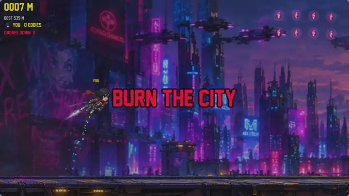
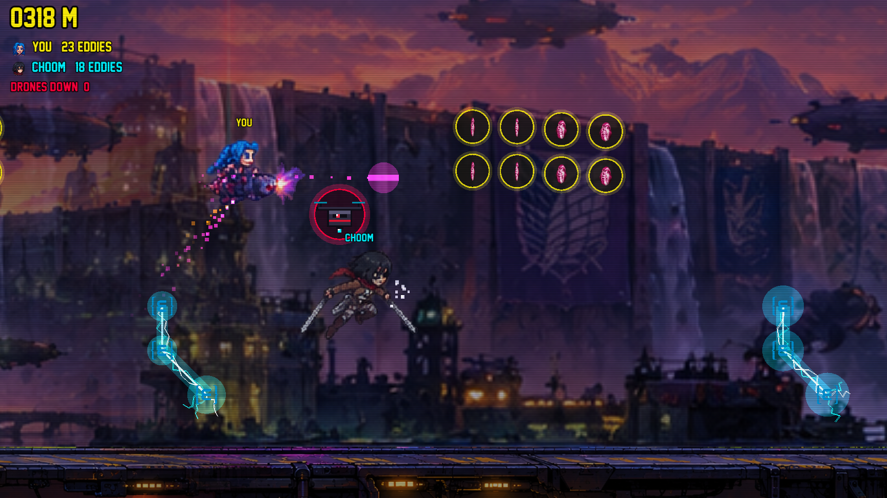
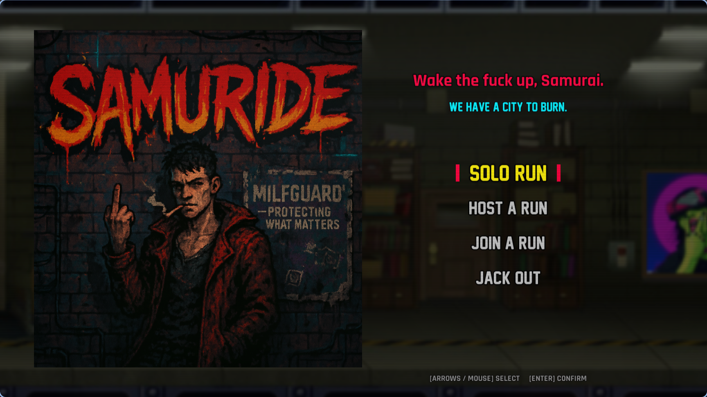
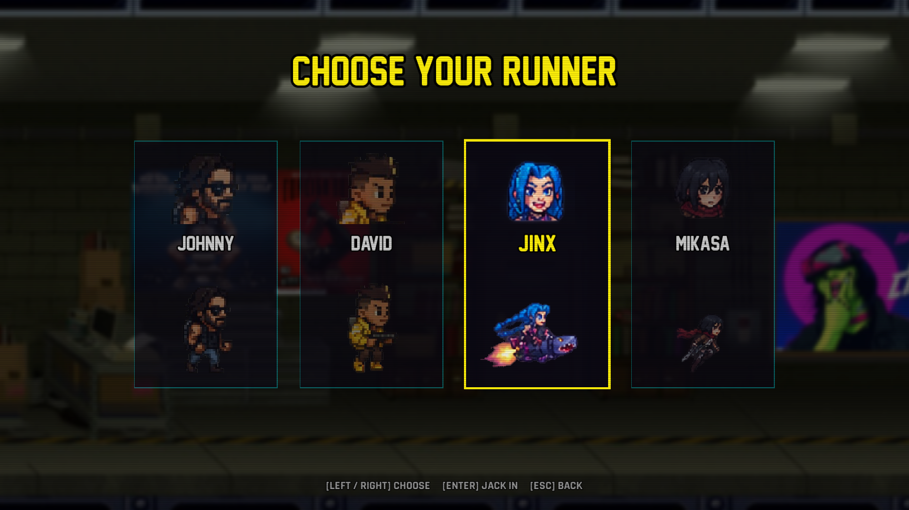
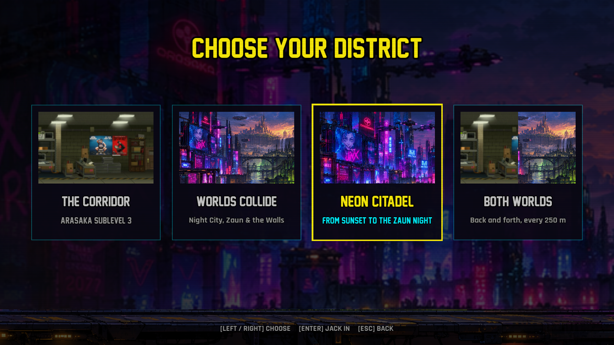

<p align="center">
  
</p>

<h3 align="center"><em>Wake the fuck up, Samurai. We have a city to burn.</em></h3>

<p align="center">
  Endless online Jetpack Joyride, rewired with a Cyberpunk 2077 soul.<br>
  C++20 · SFML 3 · custom binary TCP protocol · authoritative 60 Hz server
</p>

---

<p align="center"></p>

<p align="center"><br>
<em>Two runners, one corridor: Jinx and Mikasa in CYBERPSYCHO.</em></p>

## The run

You sprint forward on your own, the jetpack is the only thing you control. The corridor never ends: it is generated on the fly, faster and nastier the further you go.

- **Solo**: run as far as you can. Your best distance is saved.
- **Versus**: two runners, one corridor. First one to get zapped loses.
- **Eddies** (coins) come in blocks and waves, collected per player: what your choom grabs is still there for you.
- **Zappers** come as vertical, horizontal or diagonal beams. One touch and you flatline.
- **Attack Titan**: grab the rare orange orb and you stop while the smoke rises, then run for 4 seconds as Eren's titan, invincible, crushing drones and titans and sweeping up the eddies, before bursting back out of the smoke.
- **Subdermal shield**: the green hexagon takes one deadly hit for you (zapper, drone or titan), then gives you a second to get clear.
- **Sandevistan**: the magenta chevrons send you into a 3-second sprint nothing can hurt, leaving afterimages behind.
- **Berserk** (CYBERPSYCHO only): the gold crossed blades make you attack on your own, twice as often, for 8 seconds, and Lucy's RAM comes back three times faster.
- **Ultimates** (CYBERPSYCHO): every eddy you earn charges your gauge; a full one fires your runner's ultimate with `E`. Johnny palms his gun and a wall of fire sweeps the screen ahead, burning drones, zappers and titans. The other runners get theirs next. No ultimate makes you invincible.
- In CYBERPSYCHO, **one drone in three drops a shield, a Sandevistan or a Berserk** when you shoot it down.
- **Titans** charge along the floor past 300 m: a blinking red column warns you, then fly over them or get stomped. In CYBERPSYCHO, Mikasa can take their nape for +20.
- **Two modes**: CLASSIC, the original run, or **CYBERPSYCHO**: Arasaka drones block the corridor and you gun them down for +5 eddies each. Johnny and David shoot, Jinx fires her shark rockets, Mikasa slices with her blades, and Lucy hacks: the first zapper in her way goes off for a moment, or the first drone in her way goes down. She has 2 charges of RAM, one comes back every 6 seconds.
- **Six districts**: The Corridor; Night City, The Walls and Zaun, three panoramas from sunset to night; Worlds Collide, running through all three back to back; and Both Worlds, switching between the corridor and Worlds Collide every 250 m like day and night. The host picks.
- **Five runners**: Johnny, David, Jinx on her shark rocket, Mikasa and Lucy on her drone, each with their own run, take-off, flight and death animations.
- **Eddies are money**: every run's eddies go to your wallet. Johnny is free, then buy David (100), Jinx (250), Mikasa (500) and Lucy (750), in that order. The Corridor and Night City are free; buy The Walls (150), Zaun (300), Worlds Collide (500) and Both Worlds (750) in any order. Only the host needs the district.
- After a game, hit `Space` for an instant rematch.

| Key | Action |
| --- | --- |
| `Space` (hold) | Jetpack (default) |
| `F` | Attack in CYBERPSYCHO (default) |
| `E` | Ultimate in CYBERPSYCHO, once the gauge is full (default) |
| `Esc` | Back to menu |

Keys, volumes and fullscreen can be changed in **Options**; they are kept in `~/.local/share/samuride/settings`.
| Arrows / mouse + `Enter` | Menu |

<p align="center"></p>
<p align="center"></p>
<p align="center"></p>

## Download

Grab the archive for your system from the [Releases](../../releases) page. Everything the game needs is inside, nothing to install. What changed in each version: [patch notes](CHANGELOG.md).

**Windows**: unzip `samuride-<version>-windows-x86_64.zip` and run `Samuride.exe`.
- The game isn't signed, so the first launch shows *"Windows protected your PC"*: click **More info**, then **Run anyway**.
- To host a run, allow the game when the firewall asks, or your friend won't be able to join.

**macOS** (Apple Silicon, macOS 13.3 or newer): unzip `samuride-<version>-macos-arm64.zip`, which holds
`Samuride.app`. The game isn't notarized by Apple, so macOS blocks it until you clear the download flag once:

1. Open **Terminal** and type `xattr -cr ` (with the trailing space), without pressing Enter.
2. Drag `Samuride.app` from the Finder into the Terminal window: its path gets typed for you. Press Enter.
3. Double-click `Samuride.app`. You can move it to Applications like any other app.

**Linux** (x86_64, glibc 2.39 or newer: Ubuntu 24.04+, Fedora 40+, Arch...):

```sh
tar xzf samuride-*-linux-x86_64.tar.gz
cd samuride-*-linux-x86_64
./Samuride
```

Windows, macOS and Linux players can join each other. Over the Internet, the host must forward port 4242 on their router, or you both join the same [Tailscale](https://tailscale.com) or [ZeroTier](https://www.zerotier.com) network and use that address.

## Build

Linux, a C++20 compiler and **SFML 3**.

```sh
sudo pacman -S sfml      # Arch / CachyOS
make                     # Samuride_server + Samuride
make tests               # protocol, map streaming & generator self-checks
```

SFML 3 installed somewhere else? Point the Makefile at it: `make SFML_DIR=/path/to/sfml`.
`tools/package_release.sh` builds the same self-contained archive as the Releases page, and
`tools/package_windows.sh` cross-compiles the Windows one with MinGW (`make TARGET=windows` underneath),
and `tools/package_macos.sh` builds the macOS one on a Mac.
To publish a version, add its `## vX.Y` section to [CHANGELOG.md](CHANGELOG.md), then push the `vX.Y` tag:
the release workflow builds the three archives and uses that section as the release description.

## Play

```sh
./Samuride
```

That's it: **Solo** and **Host** start a server in the background for you. To play with a friend on your network, one picks **Host a run**, the other **Join a run** and types the address shown on the host's screen.

A dedicated server and direct connection are available too:

```sh
./Samuride_server -p 4242 [-m maps/small_good.txt] [-s] [-d]
./Samuride -h 127.0.0.1 -p 4242 [-c 2] [-d]
```

`-c` picks the character (0 Johnny, 1 David, 2 Jinx, 3 Mikasa), `-m` starts the run on a hand-made map before going procedural, `-s` is solo mode, `-d` prints debug logs (packets, inputs).

## Under the hood

- **Server**: single `poll()` loop with a fixed 60 Hz tick. It owns physics, collisions, scoring and map generation; clients only send "jetpack on/off".
- **Endless map**: generated in 40-column chunks ahead of the leader and streamed to clients as the run goes on. Patterns get denser over time, and every column always leaves room to get through.
- **Client**: a network thread fills the game state, the main thread renders it at 60 FPS, smoothing positions between server ticks.
- **Characters**: `tools/slice_sheets.py` turns hand-laid sprite sheets (labels, uneven spacing, trails overlapping the next frame) into aligned grids plus a `meta.txt` per character. Frames are found from the characters' bodies, every blob is assigned to its owner, and each frame is re-anchored on the feet or the body centre so animations don't wobble.
- **Protocol**: 4-byte header (1 byte type + 3 bytes payload size), packets reassembled from the TCP stream. Full spec in [`docs/PROTOCOL.md`](docs/PROTOCOL.md).

### Hand-made maps

Plain text, one character per tile, all lines the same length:

| Char | Tile |
| --- | --- |
| `_` | empty |
| `c` | eddie (coin) |
| `e` | zapper |
| `d` | drone (CYBERPSYCHO) |
| `p` | Attack Titan orb |
| `a` | shield |
| `v` | Sandevistan |

## Crew

Aymeric — started as an Epitech project (B-NWP jetpack).

Rajdhani font by Indian Type Foundry, under the SIL Open Font License.

Non-commercial fan project. Johnny Silverhand and David Martinez belong to CD Projekt, Jinx to Riot Games, Mikasa Ackerman to Hajime Isayama / Kodansha. Not affiliated with any of them.
